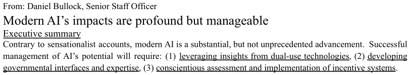

As part of the AAAS STPF application process candidates are tasked with writing a one page memo targeting an agency official of their choice, discussing one of several topics.  During the 2022 application season, one of the many options was to write about AI.  The attached is my memo, pitched at an audience that is relatively unfamiliar with the contemporary state of AI.

